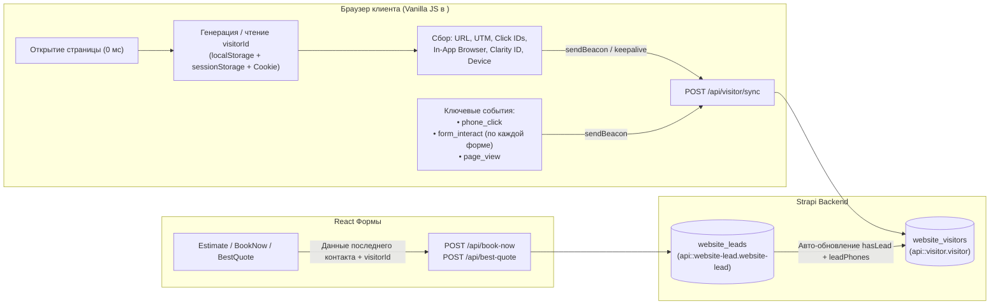

# Архитектура трекинга посетителей и атрибуции (TVPro Visitor Tracking)

## 1. Обзор архитектуры

Система трекинга TVPro разделяет **историю посещений пользователя (`Visitor`)** и **отправку лид-форм (`Website Lead`)** на два независимых контура, связанных единым внутренним идентификатором `visitorId`.

### Ключевые принципы:
1. **Независимость от React (Standalone Vanilla JS в `<head>`)**:
   - Скрипт трекера (`window.TVPTracker`) встраивается инлайном первой строкой в `<head>` HTML-документа (`src/lib/visitorTrackerScript.js` → `src/app/layout.js`).
   - Он инициализируется синхронно за `0 мс` при открытии страницы — еще **до загрузки и гидратации React**, до редиректов роутера и сторонних тегов.
   - Отправка данных в Strapi происходит неблокирующим образом через `navigator.sendBeacon()` (с фоллбэком на `fetch(..., { keepalive: true })`), поэтому запросы не отменяются браузером даже при мгновенном закрытии вкладки или переходе между страницами.
2. **Сохранение всех живых посетителей (Вариант 1)**:
   - В базу Strapi (`website_visitors`) сохраняются **все реальные посетители** сразу при открытии сайта: рекламный трафик, органика (`google_organic`, `bing_organic`), рефералы и прямые заходы (`direct`).
   - Поисковые боты, краулеры и синтетические тесты (`Googlebot`, `Bingbot`, `AhrefsBot`, `Lighthouse`, `HeadlessChrome`, `navigator.webdriver`) автоматически отсекаются на клиенте и на сервере.
3. **Простота форм в React**:
   - Формы (`Estimate`, `BookNow`, `BestQuote`, `ExitIntent`) работают по классической схеме: отправляют данные последнего контакта (`utm_*`, `fbclid`, `gclid` и т.д.) + поле `visitorId`.
   - Вся многоканальная история (`touchpoints`), слепок устройства, IP/гео и цепочка взаимодействий с формами хранятся в коллекции `Visitor` (`api::visitor.visitor`) и доступны по `visitorId`.

---

## 2. Схема работы



---

## 3. Формат внутреннего ID (`visitorId`)

Каждый посетитель получает уникальный самоописываемый идентификатор со временем создания через точку в конце (по аналогии с форматом Facebook `_fbc`):

```text
tvp_<YYMMDD>_<firstSourceCode>_<random8>.<timestamp>
```

### Примеры:
* `tvp_261017_fb_9f8a2b1c.1729182000123` — впервые зашел 17 октября 2026 из Facebook Ads в `1729182000123` (Unix ms).
* `tvp_261017_ggl_4d7e1a9b.1729185412900` — впервые зашел 17 октября 2026 из Google Ads.
* `tvp_261017_ig_3c8m2p5x.1729189100450` — впервые зашел из Instagram (по метке или через встроенный браузер Instagram).
* `tvp_261017_org_7k2n9v4q.1729190200111` — впервые зашел из органического поиска Google / Bing.
* `tvp_261017_dir_1a2b3c4d.1729195000000` — прямой заход (Direct).

### Таблица кодов первого источника (`<firstSourceCode>`):

| Код в ID | Значение `source` в БД | Как определяется при первом входе |
| :--- | :--- | :--- |
| `fb` | `facebook` | Наличие `fbclid`, `utm_source=fb/facebook/meta`, `Facebook In-App` в User-Agent или реферер `facebook.com` |
| `ig` | `instagram` | `utm_source=ig/instagram`, `Instagram` в User-Agent или реферер `instagram.com` |
| `ggl` | `google` | Наличие `gclid`, `gbraid`, `wbraid` или `utm_source=google/adwords/ppc` |
| `bing` | `bing` | Наличие `msclkid` или `utm_source=bing` |
| `oai` | `openai` | Наличие `openAIsource` или реферер `chatgpt.com` / `openai.com` |
| `org` | `google_organic` / `bing_organic` / `organic` | Переход из поисковика (`google.*`, `bing.com`, `yahoo.com`, `duckduckgo.com`) без рекламных меток |
| `yelp` | `yelp` | Реферер `yelp.com` или `utm_source=yelp` |
| `ref` | `referral` | Переход с любого другого внешнего сайта |
| `dir` | `direct` | Прямой вход без меток и внешнего реферера |

### Тройное хранение в браузере:
Чтобы `visitorId` не терялся при переходах между страницами или очистке одного из хранилищ, он синхронно записывается в:
1. `localStorage.getItem("tvp_vid")`
2. `sessionStorage.getItem("tvp_vid")`
3. First-party Cookie `tvp_vid` (`max-age=31536000` — 1 год, `path=/; SameSite=Lax`)

---

## 4. Детализация ключевых взаимодействий (`keyEvents` и `form_interact`)

Видеозапись сессии и тепловые карты ведет **Microsoft Clarity** (в `Visitor.clarityId` автоматически сохраняется ID пользователя из куки `_clck`, а в сам Clarity передается тег `visitorId`).  
Поэтому в массив `keyEvents` в Strapi записываются **только ключевые события воронки**:

### 4.1. Типы событий в `keyEvents`:
1. `visit_start` — старт новой сессии посетителя.
2. `page_view` — переход на страницу (при первой загрузке или SPA-переходе).
3. `phone_click` — клик по любому номеру телефона (`<a href="tel:...">`):
   ```json
   {
     "type": "phone_click",
     "phone": "+18325550199",
     "label": "(832) 555-0199",
     "page": "/houston/",
     "timestamp": "2026-10-17T16:30:12.410Z"
   }
   ```
4. `form_interact` — взаимодействие с конкретной формой.
5. `form_submit_success` — успешное создание лида в БД Strapi (проставляется бэкендом при сохранении заявки).

### 4.2. Справочник названий форм (`formName` в `form_interact`):

Каждой форме на сайте присвоен атрибут `data-form-name` и явный идентификатор:

| `formName` | Где находится форма | Компонент |
| :--- | :--- | :--- |
| `estimate_page_form` | Страница `/estimate` | `src/app/estimate/EstimateClient.jsx` |
| `book_now_page_form` | Страница `/book-now` | `src/app/book-now/BookNowClient.jsx` |
| `book_now_modal` | Модальное окно «Get a Quick Quote» | `src/modals/BookNowModal/BookNowModal.js` |
| `best_quote_modal` | Модальное окно калькулятора «Best Quote» | `src/modals/BestQuoteModal/BestQuoteModal.js` |
| `exit_intent_modal` | Всплывающее окно при уходе («Wait! Get $30 OFF») | `src/modals/ExitIntentModal/ExitIntentModal.js` |
| `careers_modal` | Модальное окно анкеты техника | `src/modals/CareersModal/CareersModal.js` |
| `quiz_calculator_form` | Страница калькулятора `/quiz` | `src/app/quiz/*` |

### 4.3. Действия (`action`) внутри `form_interact`:
* `modal_open` — пользователь открыл модальное окно с формой (`book_now_modal`, `best_quote_modal`, `exit_intent_modal`, `careers_modal`).
* `field_interact` — пользователь поставил фокус / начал вводить данные в конкретное поле формы (`field: "name" | "phone" | "email" | "zip" | "address"`). Дедуплицируется (1 раз на каждое поле формы за сессию), чтобы не спамить на каждое нажатие клавиши.
* `option_select` — выбор чипса на странице `/estimate` (`field: "tvCount" | "timing"`, `value: "2–3 TVs"`).
* `step_change` — переход между шагами в `best_quote_modal` (`step: 2`, `stepId: "mounting"`).
* `submit_click` — нажатие кнопки отправки формы (уходит мгновенно через `sendBeacon` в момент клика до ответа сервера).

Пример записи `form_interact`:
```json
{
  "type": "form_interact",
  "formName": "estimate_page_form",
  "action": "submit_click",
  "tvCount": "2–3 TVs",
  "timing": "As soon as possible",
  "page": "/estimate/",
  "timestamp": "2026-10-17T16:31:05.892Z"
}
```

---

## 5. Структура данных в Strapi

### 5.1. Коллекция `Visitor` (`api::visitor.visitor`, таблица `website_visitors`)
Файл схемы: `src/api/visitor/content-types/visitor/schema.json`

Основные поля:
* `visitorId` (`string`, unique) — внутренний ID (`tvp_261017_fb_9f8a2b1c.1729182000123`).
* `firstSource` (`string`) — источник самого первого визита (`facebook`, `google`, `google_organic`, `direct` и т.д.).
* `lastSource` (`string`) — источник последнего визита.
* `conversionPath` (`string`) — цепочка источников всех касаний (например: `facebook → google` или `instagram → direct`).
* `visitsCount` (`integer`) — количество записанных точек входа (`touchpoints`).
* `eventsCount` (`integer`) — общее количество ключевых взаимодействий (`keyEvents`).
* `hasLead` (`boolean`) — `true`, если посетитель успешно отправил хотя бы одну форму.
* `leadPhones` (`string`) — телефон(ы), указанные посетителем при отправке формы.
* `firstLandingPage` / `lastPage` (`string`) — страница первого входа и последняя просмотренная страница.
* `fbclid`, `gclid`, `gbraid`, `wbraid`, `msclkid`, `utm_source`, `utm_medium`, `utm_campaign`, `utm_content`, `utm_term` — все рекламные идентификаторы (работают по правилу **monotonic merge**: никогда не затираются пустыми значениями при переходах по сайту).
* `clarityId`, `_fbp`, `_fbc`, `_ga`, `_gcl_au` — идентификаторы систем аналитики.
* `ip`, `ipCity`, `ipRegion`, `ipCountry` — определяются автоматически на бэкенде из заголовков Cloudflare / прокси (`cf-connecting-ip`, `cf-ipcity`, `cf-ipregion`, `cf-ipcountry`, `x-forwarded-for`).
* `browserApp` (`string`) — распознанное приложение браузера (`Instagram In-App`, `Facebook In-App`, `Safari iOS`, `Chrome Desktop` и т.д.).
* `device` (`json`) — детальный технический слепок (`screen`, `viewport`, `timezone`, `language`, `platform`, `hardwareConcurrency`, `deviceMemory`, `connectionType`, `isInAppBrowser`).
* `touchpoints` (`json`) — массив всех визитов с параметрами URL, временем и реферером.
* `pagesVisited` (`json`) — массив посещенных страниц по порядку (`["/estimate/", "/", "/houston/"]`).
* `keyEvents` (`json`) — хронологический массив ключевых действий (`visit_start`, `page_view`, `phone_click`, `form_interact`, `form_submit_success`).
* `firstSeenAt` / `lastSeenAt` (`datetime`) — время первого и последнего контакта.

### 5.2. Коллекция `Website Lead` (`api::website-lead.website-lead`, таблица `website_leads`)
Файл схемы: `src/api/website-lead/content-types/website-lead/schema.json`

* Добавлено поле верхнего уровня `visitorId` (`string`), а также `details.visitorId`.
* При сохранении заявки в `createWebsiteLeadInDb` (`src/api/workiz-lead/controllers/workiz-lead.js`):
  1. Лид сохраняется со всеми параметрами последнего контакта и `visitorId`.
  2. В связанной записи `Visitor` автоматически проставляется `hasLead = true`, добавляется номер телефона в `leadPhones` и записывается событие `form_submit_success`.
  3. В уведомление Telegram добавляется строка `🆔 Visitor ID: tvp_...`.

---

## 6. API Эндпоинты

### 1. `POST /api/visitor/sync` (Public, `auth: false`)
Принимает пакеты от Vanilla JS скрипта (`navigator.sendBeacon` с `text/plain` или `fetch` с `application/json`).
* Выполняет потокобезопасный `upsert` по `visitorId`.
* Дополняет массивы `touchpoints`, `pagesVisited`, `keyEvents` и сохраняет новые `fbclid`/`gclid`/`utm_*`, не стирая старые.

### 2. `GET /api/visitor/by-id/:visitorId` (Public)
Возвращает полный профиль посетителя из `website_visitors` вместе с массивом всех его заявок `leads` из `website_leads`:
```bash
curl https://strapi-production-20d6.up.railway.app/api/visitor/by-id/tvp_261017_fb_9f8a2b1c.1729182000123
```

---

## 7. Публичный JS API на клиенте (`window.TVPTracker`)

В браузере глобально доступен объект `window.TVPTracker`:
* `window.TVPTracker.getVisitorId()` — возвращает текущий `visitorId`.
* `window.TVPTracker.getSessionId()` — возвращает ID текущей вкладки/сессии (`sess_...`).
* `window.TVPTracker.getParams()` — возвращает объект параметров последнего контакта + `visitorId` (используется в `getUtmParams()`).
* `window.TVPTracker.trackFormInteract(formName, action, details)` — отправляет детализированное событие взаимодействия с формой.
* `window.TVPTracker.trackEvent(eventObj)` — отправляет произвольное ключевое событие в `keyEvents`.
